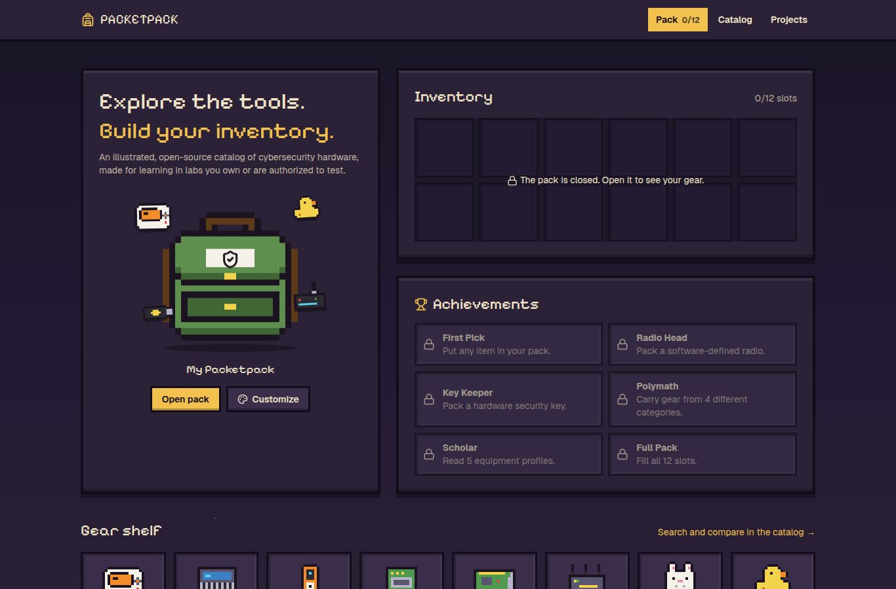
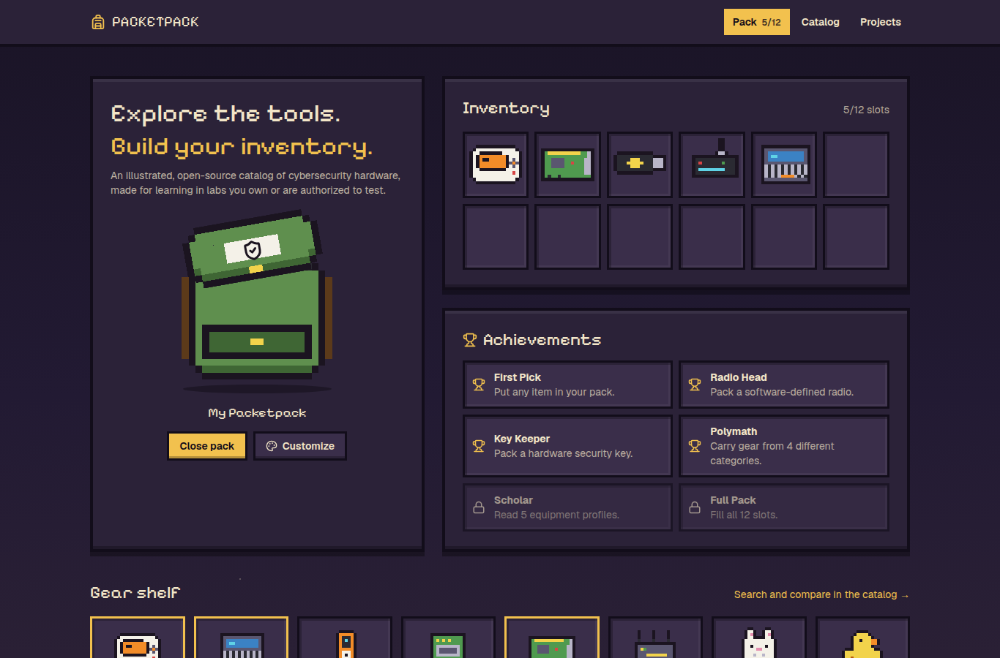
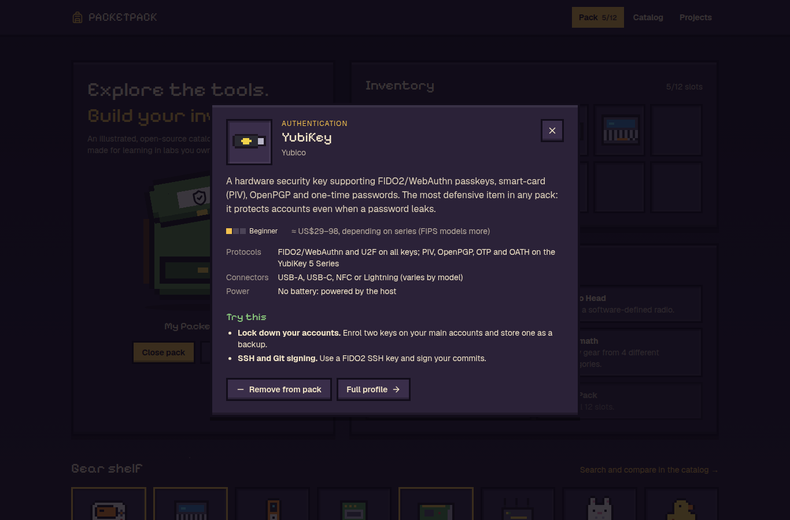
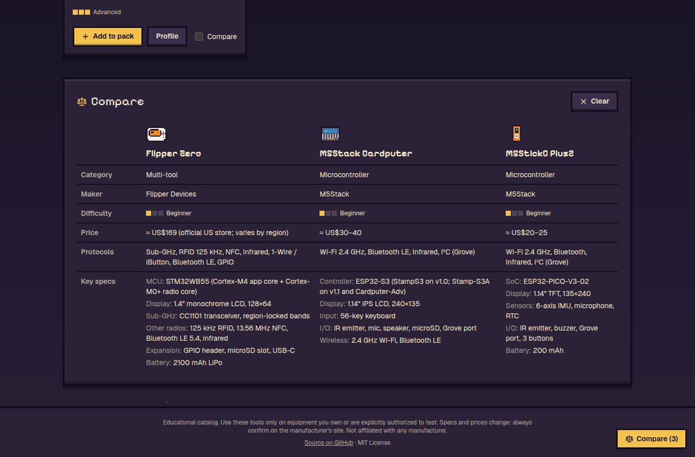

# PACKETPACK

**Explore the tools. Understand the technology. Build your own inventory.**

PACKETPACK is an open-source, interactive catalog of cybersecurity hardware, built like an indie game inventory. Open a pixel-art backpack, pick gear from the shelf, read what each device does and how it works, compare devices side by side and find hands-on projects to learn with.

It's an educational project. Every profile describes what a device is for, how it is used for learning and defense, and which projects you can try **on equipment you own, in an isolated lab, or with explicit written authorization**. It doesn't host payloads, exploits or attack tooling.

Live: [packetpack.vercel.app](https://packetpack.vercel.app)

## Screenshots

| Closed pack | Open pack |
| --- | --- |
|  |  |

| Equipment panel | Catalog |
| --- | --- |
|  |  |

| Compare | Mobile |
| --- | --- |
|  |  |

## Features

- **Interactive backpack.** Click it to open: the flap lifts and your gear pops into a 12-slot inventory.
- **Customization.** Name your pack and pick its colour, straps and patch.
- **Gear shelf and catalog.** 16 devices with search by name, maker or protocol, plus category and difficulty filters.
- **Equipment profiles.** Each one has a description, manufacturer, official links, specs, protocols, learning, defense and authorized-testing uses, difficulty, an approximate price, GitHub and community resources, and related gear.
- **Compare.** Put up to 3 devices side by side.
- **Project discovery.** Every device comes with project ideas. Filter them by difficulty or by "only gear in my pack".
- **Achievements.** Unlocked by what you pack and how many profiles you read.
- **Saved locally.** Your pack, its look and your progress stay in your browser (`localStorage`). There are no accounts and no server.
- **Accessible.** The UI is keyboard navigable, the detail panel is a native `<dialog>` (focus trap, Esc to close), sprites have text labels, animations respect `prefers-reduced-motion`, and the layout works at 375 px.

### Catalog

Flipper Zero, M5Stack Cardputer, M5StickC Plus2, ESP32 Marauder, Raspberry Pi 5, WiFi Pineapple, Bash Bunny, USB Rubber Ducky, O.MG Cable, LAN Turtle, Packet Squirrel, HackRF One, RTL-SDR Blog V4, Proxmark3, YubiKey and Ubertooth One.

## Getting started

Requirements: Node.js 20.9+ (Node 24 recommended; `npm run check` needs Node 22.18+ to run TypeScript directly).

```bash
git clone https://github.com/Amad3eu/packetpack.git
cd packetpack
npm install
npm run dev
```

Open http://localhost:3000.

| Command | What it does |
| --- | --- |
| `npm run dev` | Development server |
| `npm run build` | Production build (also type-checks) |
| `npm start` | Serve the production build |
| `npm run lint` | ESLint |
| `npm run check` | Validates the catalog data, pixel sprites and achievement rules |

## Tech stack

Next.js 16 (App Router, Cache Components), React 19, TypeScript, Tailwind CSS 4, Framer Motion, Lucide icons. Every page is prerendered at build time, including one static page per device.

## Project structure

```
src/
  app/                 routes: / (pack), /catalog, /gear/[slug], /projects
  components/          backpack, pixel sprite renderer, panels, catalog, project board
  data/equipment.ts    the catalog (one object per device)
  data/sprites.ts      pixel art as text grids + palette
  lib/achievements.ts  achievement rules
scripts/check-data.mts data and sprite validation
docs/screenshots/      images used in this README
```

The illustrations are original pixel art drawn as text grids (one character per pixel) and rendered as SVG. There are no product photos and no image files to load.

## Deploying to Vercel

1. Fork or push this repository to your GitHub account.
2. On [vercel.com/new](https://vercel.com/new), import the repository. Vercel detects Next.js automatically.
3. Keep the defaults (build command `npm run build`). No environment variables are needed.
4. Deploy. Every push to `main` deploys again, and pull requests get preview URLs.

From the CLI instead: `npx vercel` for a preview, `npx vercel --prod` for production.

## Contributing

New devices, corrections and project ideas are welcome. Read [CONTRIBUTING.md](CONTRIBUTING.md) first: it covers how to add a device, the sourcing rules for specs and prices, and the content scope.

## Known limitations

- **Specs and prices change.** The catalog was fact-checked on 2026-11-10 against manufacturer docs. Some official stores (the Hak5 shop, raspberrypi.com, flipper.net) block automated requests, so a few prices come from search results of the manufacturers' own pages. Prices are shown as approximate ranges, and every profile links to the official source. Several products have been retired or replaced; those carry a status note.
- **Your pack lives only in this browser.** Clearing site data empties it, and there is no sync or sharing between devices yet.
- **English only.**
- **No automated UI tests yet.** `npm run check` covers the data and the achievement rules, and the interface was checked by hand in desktop and mobile Chrome.
- **The sprites are stylized,** not technical drawings of each product.

## Disclaimer

PACKETPACK is not affiliated with any manufacturer listed. Product names and trademarks belong to their owners. Use security tools only on systems and devices you own or are explicitly authorized to test, and follow your local laws, including radio transmission rules.

## License

[MIT](LICENSE)
