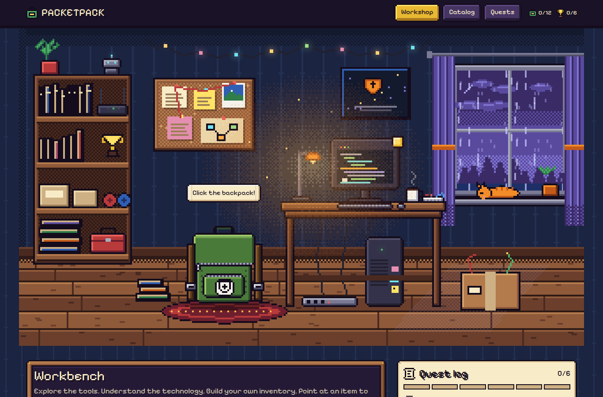
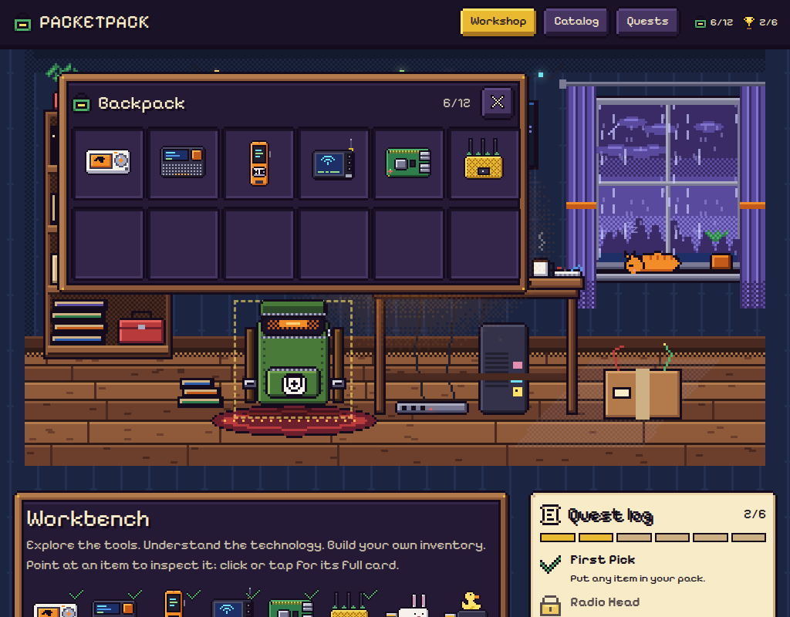
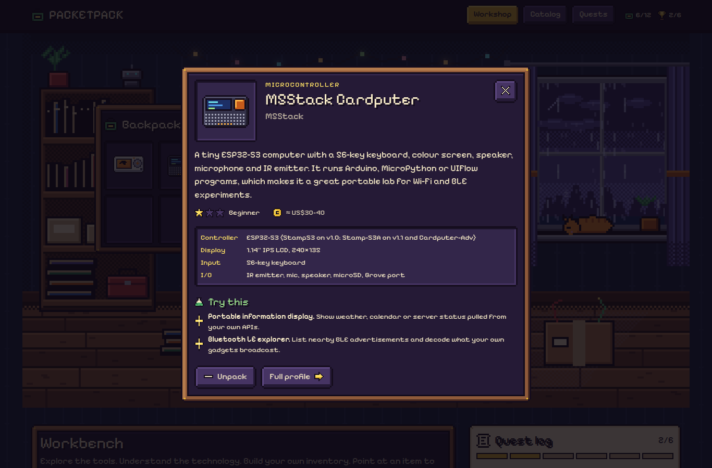
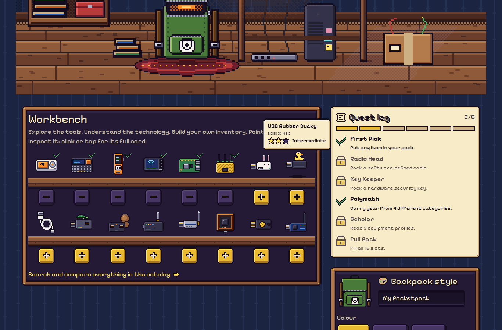
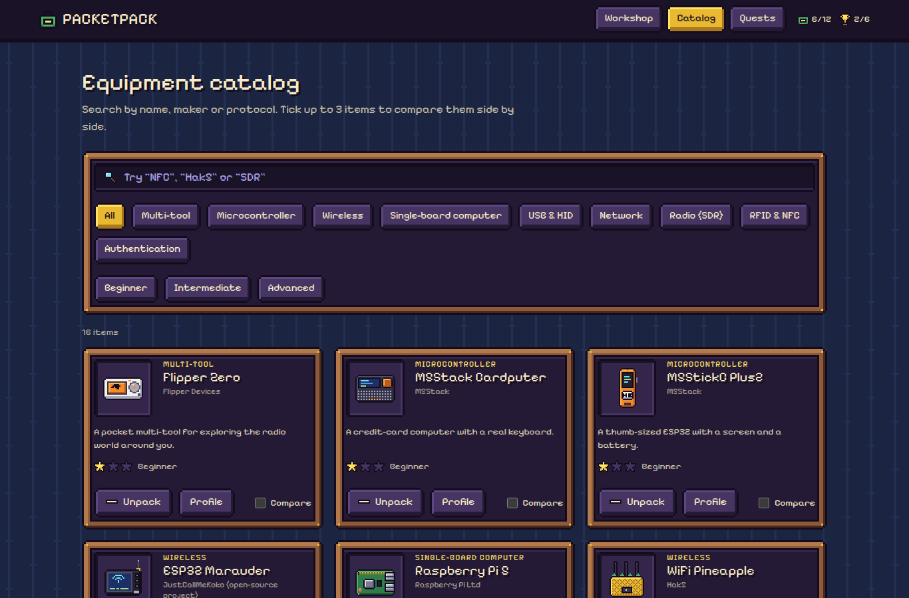
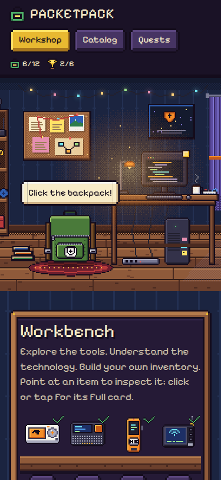

# PACKETPACK

**Explore the tools. Understand the technology. Build your own inventory.**

PACKETPACK is an open-source, pixel-art game about exploring cybersecurity hardware. You're in a small workshop bedroom at night: rain on the window, a cat asleep on the sill, a lamp over the desk. Unzip your backpack, pick gear from the workbench, read what each device does, compare devices and pin project ideas to the quest board.

It's an educational project. Every device card says what the hardware is for, how it's used for learning and defense, and which projects you can try **on equipment you own, in an isolated lab, or with explicit written authorization**. It doesn't host payloads, exploits or attack tooling.

Live: [packetpack.vercel.app](https://packetpack.vercel.app)

## Screenshots

| The workshop | Backpack open |
| --- | --- |
|  |  |

| Item card | Workbench and quest log |
| --- | --- |
|  |  |

| Catalog | Mobile |
| --- | --- |
|  |  |

## Features

- **A living room to explore.** Rain falls past the window, the monitor scrolls code, LEDs and fairy lights blink, dust drifts in the lamp light and the cat breathes in its sleep. The bookshelf opens the catalog and the corkboard opens the quest board.
- **The backpack.** Click it: the zipper runs along the seam, the flap flips back and the inventory rises out of the bag. Items idle with a one-pixel bob; hover one and it lifts, casts a shadow and shows a pixel tooltip.
- **Customization.** Name your pack and pick its colour, straps and patch.
- **Workbench and catalog.** 16 devices, each with its own pixel sprite. The catalog adds search by name, maker or protocol, category and difficulty filters, and a side-by-side comparison of up to 3 devices.
- **Device cards and profiles.** Each one has a description, manufacturer, official links, specs, protocols, learning, defense and authorized-testing uses, difficulty, an approximate price, GitHub and community resources, and related gear.
- **Quest board.** Every device comes with project ideas. Filter them by difficulty or by "only gear in my pack"; the ones for your own gear are pinned in the workshop.
- **A secret room.** Pull the trophy on the bookshelf: the bookcase rumbles and swings open on its hinge, showing a hidden stone alcove with a pixel trophy for every quest. Unlocked ones shine and locked ones are dark silhouettes. Esc or Close shuts it.
- **Quest log.** RPG-style achievements unlocked by what you pack and how many profiles you read, also listed below the room.
- **Saved locally.** Your pack, its look and your progress stay in your browser (`localStorage`). There are no accounts and no server.
- **Accessible.** Every hotspot and item is a real button or link with a label, the item card is a native `<dialog>` (focus trap, Esc to close), tooltips also open on keyboard focus, and all animation stops with `prefers-reduced-motion`.

### Catalog

Flipper Zero, M5Stack Cardputer, M5StickC Plus2, ESP32 Marauder, Raspberry Pi 5, WiFi Pineapple, Bash Bunny, USB Rubber Ducky, O.MG Cable, LAN Turtle, Packet Squirrel, HackRF One, RTL-SDR Blog V4, Proxmark3, YubiKey and Ubertooth One.

## Getting started

Requirements: Node.js 22.18+ (Node 24 recommended). The art and check scripts run TypeScript directly in Node.

```bash
git clone https://github.com/Amad3eu/packetpack.git
cd packetpack
npm install
npm run dev
```

Open <http://localhost:3000>.

| Command | What it does |
| --- | --- |
| `npm run dev` | Development server |
| `npm run build` | Production build (also type-checks) |
| `npm start` | Serve the production build |
| `npm run lint` | ESLint |
| `npm run art` | Repaint every sprite into `public/art/` |
| `npm run check` | Validates the catalog, the achievement rules, and that `public/art/` matches the art source |

## How the art works

Every pixel is drawn in code. There are no image editors, no product photos and no SVG illustrations.

- `art/canvas.mts` is a tiny RGBA canvas with a dependency-free PNG encoder. It provides pixels, shaded boxes, Bayer dithering and text-grid stamps.
- `art/palette.mts` is the one limited palette everything shares.
- `art/items.mts`, `art/backpack.mts`, `art/scene.mts`, `art/achievements.mts` and `art/ui.mts` paint the devices, the 4-frame backpack, the bedroom (including the bookcase door and the secret alcove) with its animation sheets, the quest trophies, and the game-menu frames and icons.
- `npm run art` writes the PNGs to `public/art/`. They are committed, so a deploy doesn't need to run it.

On the page, sprites are `` elements with `image-rendering: pixelated`, always shown at whole-number scales. The room is 320×180 native pixels scaled ×2, ×3 or ×4 by screen width. Menu frames are 9-slice PNGs pre-scaled ×3 and used through CSS `border-image`, so they stay crisp in every browser. Animations use CSS `steps()`, so things move one pixel at a time. Framer Motion handles the inventory pop-up.

Scene positions live in `src/lib/scene.ts`. Both the painter and the React hotspots read that file, so they can't drift apart.

## Tech stack

Next.js 16 (App Router, Cache Components), React 19, TypeScript, Tailwind CSS 4 and Framer Motion. The font is Jersey 10, a pixel font chosen because its digits stay distinct (5 vs S, 0 vs O), which matters in a catalog of specs. Every page is prerendered at build time, including one static page per device.

## Project structure

```text
art/                   pixel-art source: canvas + PNG encoder, palette, items, backpack, scene, UI
public/art/            generated PNGs (run npm run art)
src/
  app/                 routes: / (workshop), /catalog, /gear/[slug], /projects
  components/          room scene, backpack, inventory, item card, catalog, quest board
  data/equipment.ts    the catalog (one object per device)
  lib/scene.ts         scene layout shared by the art and the UI
  lib/achievements.ts  quest rules
scripts/check-data.mts validation run by npm run check
docs/screenshots/      images used in this README
```

## Deploying to Vercel

1. Fork or push this repository to your GitHub account.
2. On [vercel.com/new](https://vercel.com/new), import the repository. Vercel detects Next.js automatically.
3. Keep the defaults (build command `npm run build`). No environment variables are needed.
4. Deploy. Every push to `main` deploys again, and pull requests get preview URLs.

From the CLI instead: `npx vercel` for a preview, `npx vercel --prod` for production.

## Contributing

New devices, sprites, corrections and project ideas are welcome. Read [CONTRIBUTING.md](CONTRIBUTING.md) first: it covers how to add a device and paint its sprite, the sourcing rules for specs and prices, and the content scope.

## Known limitations

- **Specs and prices change.** The catalog was fact-checked on 2026-11-10 against manufacturer docs. Some official stores (the Hak5 shop, raspberrypi.com, flipper.net) block automated requests, so a few prices come from search results of the manufacturers' own pages. Prices are shown as approximate ranges, and every profile links to the official source. Products that were retired or replaced carry a status note.
- **On phones the room scrolls sideways.** It's drawn at ×2 (640 px wide) to keep pixels whole, and opens centred on the backpack and desk. The inventory shows below the room instead of floating over it.
- **Touch screens have no hover**, so item tooltips appear only on keyboard focus. A tap opens the full item card instead.
- **The pixel font is used everywhere.** That's part of the look, but some readers may find long text harder to read than in a plain font.
- **Your pack lives only in this browser.** Clearing site data empties it, and there is no sync or sharing yet.
- **English only.** There are no automated UI tests yet: `npm run check` covers data, art and quest rules, and the interface was checked by hand in desktop and mobile Chrome.

## Credits

All art in this repository is original and drawn in code for this project. The mood draws on cozy indie games and pixel-art bedroom scenes, but no game, artist or artwork is copied.

## Disclaimer

PACKETPACK is not affiliated with any manufacturer listed. Product names and trademarks belong to their owners. Use security tools only on systems and devices you own or are explicitly authorized to test, and follow your local laws, including radio transmission rules.

## License

[MIT](LICENSE)
